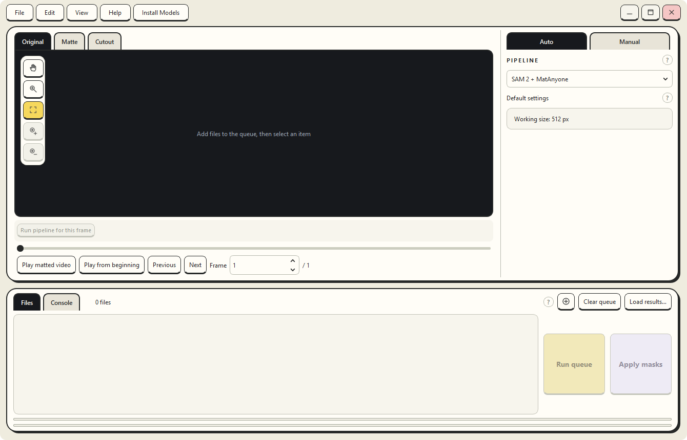
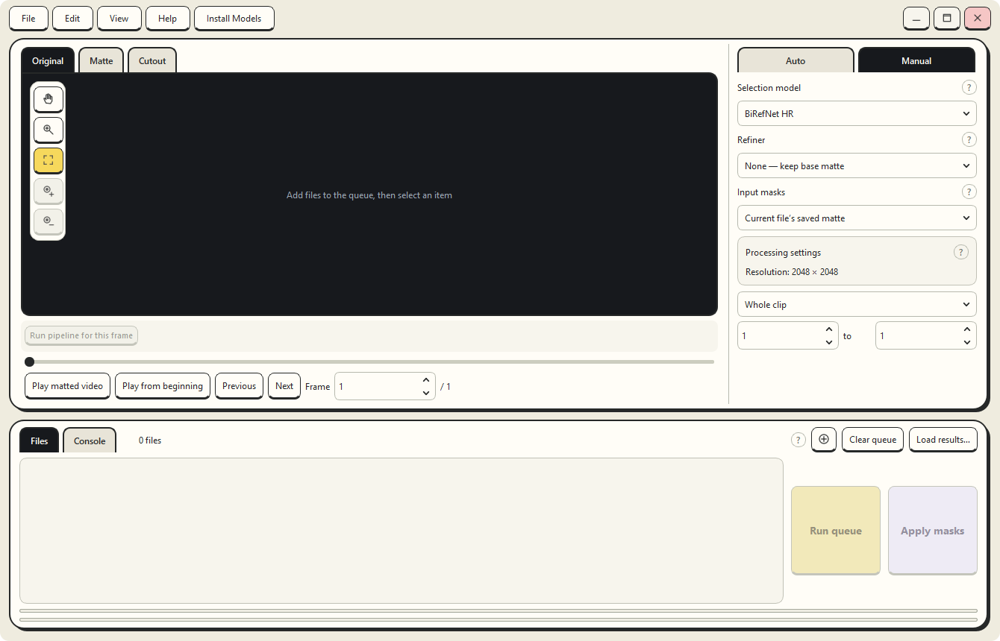
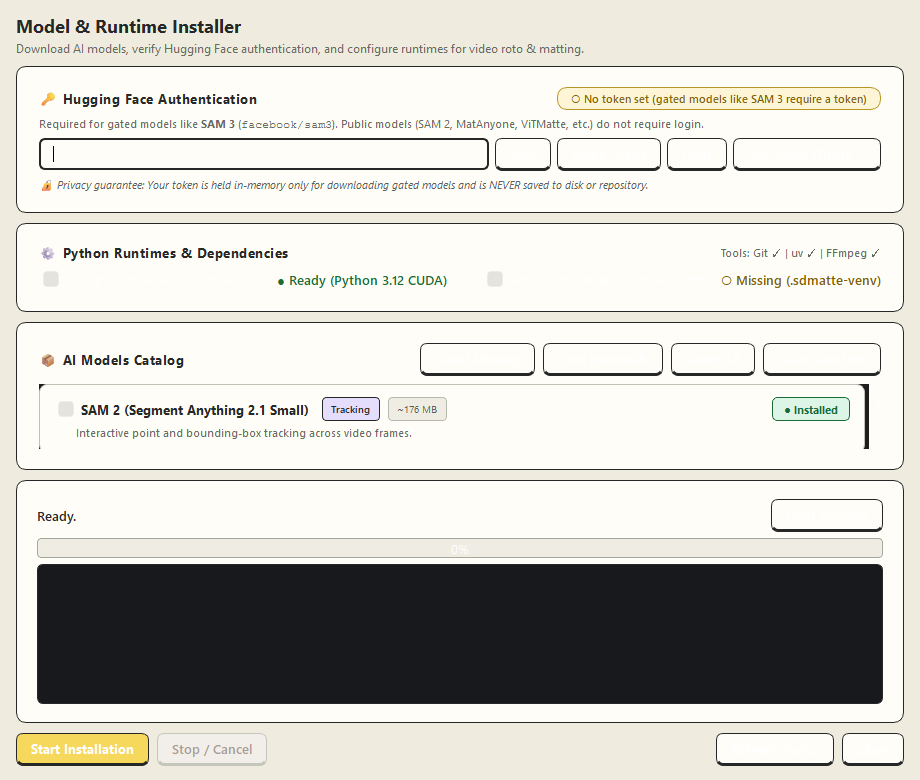

# MattApp — AI Video & Image Matting Studio

[](https://www.python.org/)
[](https://pytorch.org/)
[](https://www.qt.io/)
[](https://huggingface.co/)
[](https://microsoft.com)

**MattApp** is a high-performance desktop application for interactive rotoscoping, video matting, and image background removal. It combines modern spatial tracking (**SAM 2**, **SAM 3**, **SAM 3.1**) with temporal matting engines (**MatAnyone**, **MatAnyone 2**, **VideoMaMa**), trimap edge refiners (**ViTMatte**), and high-resolution salient matting (**BiRefNet HR**).

---

## 📸 Interface & Workflow Preview

### 1. Studio Workspace (Automatic Pipeline Mode)
Interactive video timeline, transparency checkerboard viewport, guidance tools, and batch queue:


### 2. Manual Workflow Mode (Custom Selector + Refiner Pairing)
Mix and match tracking selectors with edge refiners, tune working resolutions, and paint alpha corrections:


### 3. Model & Runtime Installer
Integrated in-app downloader with presets (**Core Essentials**, **Select Missing**), live console, environment detection, and in-memory Hugging Face authentication:


---

## ⚡ CUDA Compatibility & GPU Support

MattApp is engineered with PyTorch CUDA acceleration, supporting mixed-precision FP16 Tensor Cores and FlashAttention / SDPA memory optimization.

### Supported NVIDIA GPU Architectures

| Architecture | Representative GPUs | Compute Capability | Support Level |
| :--- | :--- | :--- | :--- |
| **Blackwell** | GeForce RTX 5090, 5080, 5070, RTX 5060 | `sm_100`, `sm_120` | Full support (CUDA 12.6+) |
| **Ada Lovelace** | GeForce RTX 4090, 4080, 4070 Ti, 4070, 4060 Ti, 4060, RTX 6000 Ada | `sm_89` | Full support (FP16 / BF16 Tensor Cores) |
| **Ampere** | GeForce RTX 3090, 3080 Ti, 3080, 3070, 3060 (12GB), A100, A6000, A10 | `sm_80`, `sm_86` | Full support (FP16 / BF16 Tensor Cores) |
| **Turing** | GeForce RTX 2080 Ti, 2080 Super, 2070, 2060, Titan RTX, GTX 1660 Super/Ti | `sm_75` | Supported (FP16 acceleration) |
| **Volta & Pascal** | Titan V, GeForce GTX 1080 Ti, GTX 1080, Titan Xp | `sm_70`, `sm_61` | Supported (FP32 / native fallback) |

### CUDA Toolkit & Driver Requirements

- **Bundled / Default PyTorch**: `torch==2.6.x+cu126` (CUDA 12.6 runtime bundled).
- **Minimum NVIDIA Display Driver**:
  - **CUDA 12.x**: Driver **>= 528.33** (Recommended: **550.xx** or newer).
  - **CUDA 11.8**: Driver **>= 450.80.02**.
- **Alternative CUDA builds**: If your system requires CUDA 12.4 or 12.1, you can point `.venv` to the corresponding PyTorch wheel index without modifying app code.

### VRAM Sizing & System Requirements

| Tier | Workload / Models | Minimum VRAM | Recommended VRAM | System RAM |
| :--- | :--- | :--- | :--- | :--- |
| **Tier 1: Core Essentials** | **SAM 2 Small** + **MatAnyone** / **ViTMatte**, **BiRefNet HR** (2048×2048) | **6 GB** | **8 GB** | 16 GB |
| **Tier 2: Advanced Tracking** | **SAM 3**, **SAM 3.1 Multiplex**, **MatAnyone 2**, **SAM2Matting Base+** | **8 GB** | **12 GB** | 16 GB – 32 GB |
| **Tier 3: Temporal Diffusion** | **VideoMaMa** (SVD UNet), **LiteSDMatte** (Guided Diffusion), 4K video clips | **12 GB** | **16 GB – 24 GB+** | 32 GB+ |

> **CPU Fallback**: If an NVIDIA GPU is not present, BiRefNet HR, SAM 2, and ViTMatte can run in CPU mode for previewing and lower-resolution images.

---

## 🎯 Key Features

### 1. Dynamic Model Discovery (Clean Menus)
- The `PIPELINE`, `Selector`, `Refiner`, and `Viewport` menus **only show models currently installed on disk**.
- If you install only the **Core package**, only Core pipelines appear (`SAM 2 + MatAnyone`, `SAM 2 + ViTMatte`, and `BiRefNet HR`). Uninstalled models remain completely hidden until downloaded.

### 2. Zero-Disk Token Privacy Guarantee
- Gated models such as **SAM 3** (`facebook/sam3`) require a Hugging Face user token.
- MattApp validates tokens live against the Hugging Face API and maintains them **in-memory only**.
- **No tokens are ever written to disk, registry, environment files, or git commits.**

### 3. Dual-Stage Matting Architecture
- **Stage 1 (Selector)**: Spatial localization via bounding boxes, positive clicks (`+`), and negative clicks (`-`) using SAM 2 or SAM 3.
- **Stage 2 (Refiner)**: Temporal boundary propagation and sub-pixel edge refinement using MatAnyone, MatAnyone 2, or ViTMatte.
- **Stage 3 (Manual Canvas Editing)**: Interactive painting directly on the alpha channel:
  - **Paint White (255)**: Force subject opaque / keep hair and details.
  - **Paint Black (0)**: Suppress backgrounds, shadows, and reflections.
  - **Foreground Color Estimation**: Cleanly restores natural edge colors to prevent green/dark fringes.

---

## 📦 AI Model Catalog

| Model | Size | Purpose | License / Source |
| :--- | :--- | :--- | :--- |
| **BiRefNet HR** | ~200 MB | Instant high-res salient matting (illustrations & photo) | Apache 2.0 (`ZhengPeng7/BiRefNet_HR-matting`) |
| **SAM 2.1 Hiera Small** | ~176 MB | Fast interactive video tracking with points & boxes | Apache 2.0 (`facebook/sam2.1-hiera-small`) |
| **MatAnyone** | ~135 MB | High-consistency video matting from starting mask | Apache 2.0 (`PeiqingYang/MatAnyone`) |
| **ViTMatte Small** | ~197 MB | Vision Transformer trimap edge refinement | MIT (`hustvl/vitmatte-small-composition-1k`) |
| **MatAnyone 2** | ~135 MB | High-detail human video matting | S-Lab Non-Commercial (`PeiqingYang/MatAnyone2`) |
| **SAM 3.1 Multiplex** | ~3.3 GB | Multiplex tracking (points, boxes, and text concepts) | Research (`facebook/sam3.1`) |
| **SAM 3 Gated** | ~3.3 GB | Official Meta SAM 3 checkpoint | Meta Research (requires HF agreement) |
| **SAM2Matting** | ~571 MB | Direct soft-alpha matting (Tiny & Base+) | Research (`FudanCVL/SAM2Matting`) |
| **VideoMaMa** | ~7.2 GB | Temporal diffusion video matting with SVD | Research (`cvlab-kaist/VideoMaMa`) |
| **LiteSDMatte** | ~8.1 GB | Guided Stable Diffusion matting | Research (`LongfeiHuang/LiteSDMatte`) |

---

## 🚀 Quick Start (One-Click)

### Windows Launcher
1. Double-click **`Run Matte App.bat`** in the repository root.
   - On the first run, it automatically configures a self-contained `.venv` using the bundled portable `uv`, installs PyTorch with CUDA 12.6, and launches the studio.
   - On subsequent runs, it opens immediately.
2. In the app header, click **`Install Models`**.
3. Click **`Core Essentials`** to select the fast ~500 MB core package (SAM 2, MatAnyone, ViTMatte).
4. Click **`Start Installation`** to download and configure in the background.

### Manual / Developer Setup
```powershell
# Clone the repository
git clone https://github.com/Dr0mp/MattApp.git
cd MattApp

# Set up environment and install with uv
.\bin\uv.exe venv .venv --python 3.12
.\bin\uv.exe pip install torch torchvision --index-url https://download.pytorch.org/whl/cu126
.\bin\uv.exe pip install -e ".[birefnet]"

# Run the app
.\.venv\Scripts\python.exe main.py
```

---

## ⌨️ Keyboard Shortcuts

| Shortcut | Action |
| :--- | :--- |
| `Ctrl + O` | Open image or video file |
| `Ctrl + S` | Save current matte result |
| `Ctrl + Shift + S` | Export transparent PNG / video |
| `Ctrl + Z` | Undo canvas guidance / paint stroke |
| `Ctrl + Shift + Z` / `Ctrl + Y` | Redo canvas stroke |
| `[` / `]` | Decrease / Increase brush size |
| `Space` + Drag | Pan / Hand viewport navigation |
| `Mouse Wheel` | Zoom in / out centered on cursor |
| `Left Arrow` / `Right Arrow` | Previous / Next video frame |

---

## 🧪 Automated Testing

MattApp includes a comprehensive automated test suite covering UI components, dynamic model discovery, cancellation, and studio workflows:

```powershell
.\.venv\Scripts\python.exe -m unittest discover -s tests -p "test_*.py"
```
*(All 156 tests passing).*

---

## 📁 Repository Structure

```
MattApp/
├── Run Matte App.bat       # Single-click launcher and dependency bootstrapper
├── main.py                 # Application entry point
├── ui_components.py        # Custom Qt widgets, canvas, and layout helpers
├── ui_shell_layout.py      # Studio layout, viewport controls, and event loop
├── pyproject.toml          # Package specifications & build configuration
├── uv.lock                 # Dependency lockfile
├── README.md               # Project documentation & CUDA matrix
├── bin/                    # Portable uv executable
├── docs/                   # Documentation and interface screenshots
│   └── screenshots/
├── matte_app/              # Core application package
│   ├── app_window.py       # StudioWindow implementation
│   ├── installer_dialog.py # Model & dependency installer dialog
│   ├── installed_models.py # Dynamic model discovery and pipeline filtering
│   └── roto.py             # Inference wrappers & workers
├── scripts/                # Utility and setup scripts
├── tests/                  # 156 automated regression unit tests
└── ui_shell_assets/        # Vector icons and UI styling assets
```

---

## 📄 License

This repository's shell, GUI, and pipeline orchestration code are licensed under the **MIT License**.
Individual AI model weights and architectures maintain their respective upstream licenses (Apache 2.0, MIT, or Meta Research terms). See the Model Catalog for details.
